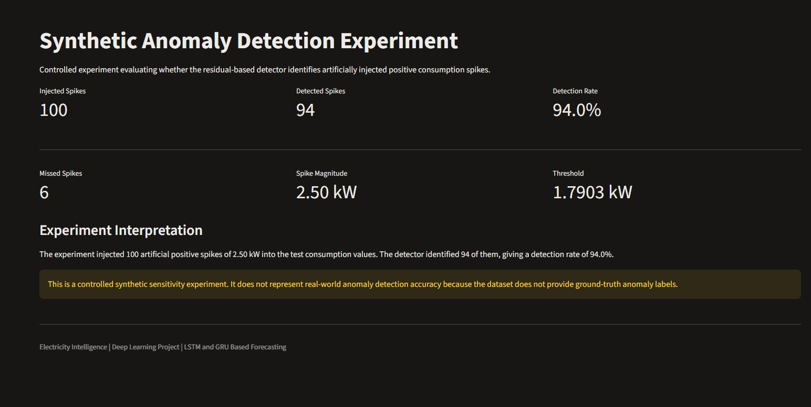
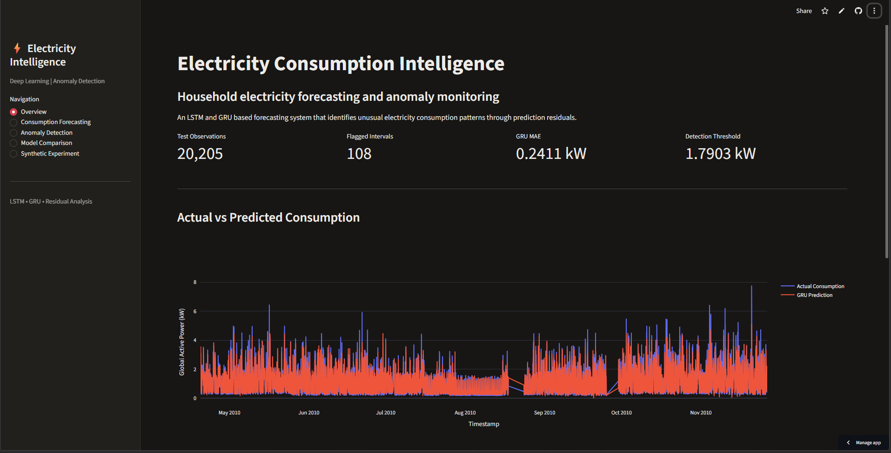
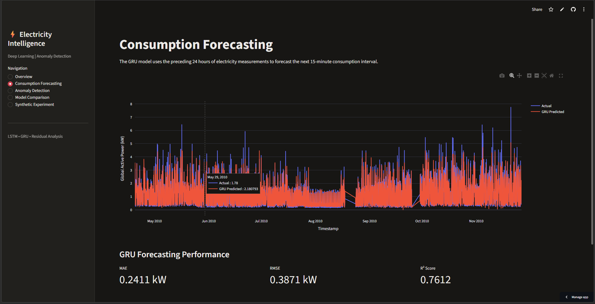
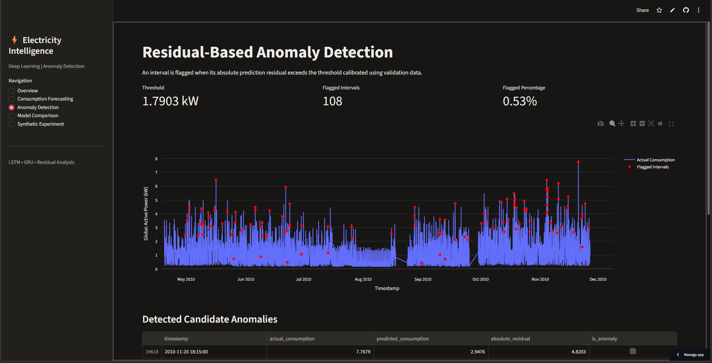
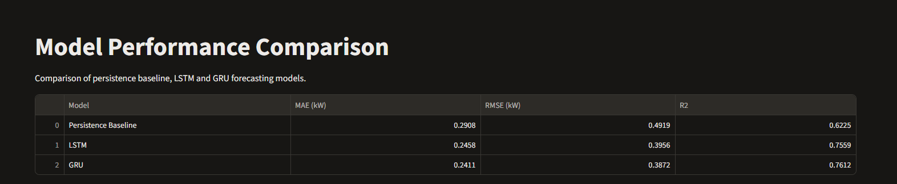

# Residual-Based Anomaly Detection in Household Electricity Consumption Using LSTM and GRU Forecasting Models

<p align="center">

  **Deep Learning | Time-Series Forecasting | Anomaly Detection**

  [Live Dashboard](https://noctiwhatt.streamlit.app/) • [GitHub Repository](https://github.com/KulkarniSukrut/Electricity-Forecasting-AD) • [Release v1.0.0](https://github.com/KulkarniSukrut/Electricity-Forecasting-AD/releases/tag/v1.0.0)

</p>

---

## Overview

Household electricity consumption varies throughout the day depending on appliance usage, occupancy, and daily routines. Identifying unusual consumption patterns can help users better understand their electricity usage and investigate unexpected changes.

This project develops a deep learning-based system for **short-term household electricity consumption forecasting and residual-based anomaly detection**.

Using the UCI Individual Household Electric Power Consumption dataset, the project implements and compares Long Short-Term Memory (LSTM) and Gated Recurrent Unit (GRU) networks to predict electricity consumption 15 minutes into the future.

The difference between actual and predicted consumption is then used to identify potentially unusual consumption intervals. A validation-based threshold determines which deviations are flagged as candidate anomalies.

An interactive Streamlit dashboard brings the forecasting results, anomaly detection outputs, model comparisons, and experimental findings together in one interface.

### Live Application

**[Launch the Electricity Forecasting & Anomaly Detection Dashboard](https://noctiwhatt.streamlit.app/)**

---

## Project Objectives

The primary objectives of this project are:

1. Explore and preprocess real-world household electricity consumption data.
2. Develop time-series forecasting models using LSTM and GRU architectures.
3. Compare deep learning models against a persistence-based forecasting baseline.
4. Evaluate forecasting performance using MAE, RMSE, and R².
5. Develop a residual-based method to identify unusual electricity consumption intervals.
6. Evaluate anomaly detection sensitivity using a controlled synthetic anomaly experiment.
7. Build an interactive dashboard to visualize and communicate the results.

---

## Problem Statement

Electricity consumption is dynamic and often contains irregular patterns caused by changes in household activity and appliance usage.

Traditional monitoring systems generally report recorded consumption values but may not identify whether a particular observation significantly deviates from expected usage.

The problem addressed in this project is:

**Can historical household electricity consumption patterns be learned using recurrent neural networks to forecast future consumption and identify potentially unusual deviations between actual and predicted values?**

The proposed approach uses:

- LSTM and GRU networks for short-term forecasting.
- A persistence baseline for comparison.
- Absolute prediction residuals for anomaly screening.
- A validation-derived statistical threshold for identifying candidate anomalies.

The system is designed as an exploratory monitoring and analysis tool. Detected anomalies are potential irregularities, not confirmed electrical faults or evidence of electricity wastage.

---

## Dataset

**Dataset:** Individual Household Electric Power Consumption

**Source:** UCI Machine Learning Repository

**Link:** https://archive.ics.uci.edu/dataset/235/individual+household+electric+power+consumption

The dataset contains approximately 2.07 million minute-level measurements collected from a single household over almost four years.

### Dataset Information

| Attribute | Description |
|---|---|
| Original observations | 2,075,259 |
| Original features | 9 columns |
| Sampling frequency | 1 minute |
| Start date | 16 December 2006 |
| End date | 26 November 2010 |
| Target variable | Global_active_power |
| Missing values | 25,979 observations in the seven electrical measurement columns |

### Important Features

| Feature | Description |
|---|---|
| Global_active_power | Household global active power consumption (kW) |
| Global_reactive_power | Household global reactive power consumption (kW) |
| Voltage | Average voltage (V) |
| Global_intensity | Current intensity (A) |
| Sub_metering_1 | Energy sub-metering for kitchen appliances (Wh) |
| Sub_metering_2 | Energy sub-metering for laundry appliances (Wh) |
| Sub_metering_3 | Energy sub-metering for climate control systems (Wh) |

The prediction target is **Global_active_power**, while the seven electrical measurement features are used as model inputs.

---

## Project Workflow

The project follows a chronological time-series machine learning pipeline.

1. Data exploration and understanding.
2. Data cleaning and preprocessing.
3. Resampling to 15-minute intervals.
4. Feature engineering and chronological splitting.
5. Sequence generation.
6. Baseline forecasting.
7. LSTM and GRU model training.
8. Forecasting performance evaluation.
9. Residual-based anomaly detection.
10. Synthetic anomaly sensitivity experiment.
11. Interactive dashboard development.

### Pipeline Architecture

```text
Raw Household Electricity Dataset
              |
              v
       Data Exploration
              |
              v
    Data Cleaning & Preprocessing
              |
              v
     15-Minute Resampling
              |
              v
    Feature Engineering
              |
              v
   Chronological Data Split
       70% / 15% / 15%
              |
              v
       Sequence Generation
      96 Time Steps x 7 Features
              |
              v
      Forecasting Models
        /      |       \
       /       |        \
Persistence   LSTM      GRU
Baseline
       \       |        /
        \      |       /
         Model Evaluation
              |
              v
       GRU Predictions
              |
              v
     Absolute Residual Calculation
              |
              v
     Validation-Based Threshold
              |
              v
      Candidate Anomaly Detection
              |
              v
       Streamlit Dashboard
```

---

## Data Preprocessing

The original dataset contains minute-level measurements and missing values. Several preprocessing steps were performed to prepare it for time-series forecasting.

### 1. Data Cleaning

- Parsed date and time columns into a unified datetime index.
- Converted electrical measurement columns into numeric values.
- Identified missing values across the electrical measurement features.
- Preserved the chronological order of observations.

### 2. Resampling

The original one-minute observations were resampled into **15-minute average intervals**.

This reduces the size of the dataset while retaining meaningful short-term electricity consumption patterns.

### 3. Missing Value Handling

A coverage-based filtering strategy was implemented.

- Each 15-minute interval should contain at least 12 valid minute-level observations.
- This represents a minimum coverage threshold of 80%.
- Intervals with insufficient valid observations were excluded.
- Long gaps were not interpolated, preventing artificial consumption patterns from being introduced.

### Preprocessing Results

| Metric | Result |
|---|---:|
| Original observations | 2,075,259 |
| Resampling frequency | 15 minutes |
| Initial 15-minute intervals | 138,352 |
| Intervals excluded due to insufficient coverage | 1,737 |
| Cleaned observations | 136,615 |
| Remaining missing values | 0 |

The cleaned dataset contains seven electrical measurement features and spans December 2006 to November 2010.

**Output:** `data/processed/electricity_15min_cleaned.csv`

---

## Feature Engineering and Data Splitting

### Chronological Train, Validation and Test Split

To prevent information from the future from influencing the training process, the dataset was divided chronologically.

| Dataset | Percentage | Observations |
|---|---:|---:|
| Training | 70% | 95,630 |
| Validation | 15% | 20,492 |
| Testing | 15% | 20,493 |
| **Total** | **100%** | **136,615** |

The validation dataset was used for model selection and anomaly threshold calibration, while the test dataset was reserved for final evaluation.

### Feature Scaling

A StandardScaler was fitted exclusively on the training dataset.

The same fitted scaler was then applied to the validation and test datasets.

This prevents data leakage from future observations into the training process.

### Sequence Generation

The forecasting models use a sliding-window sequence approach.

Each input sequence contains:

- 96 previous time steps.
- 7 electrical measurement features.
- A 24-hour historical observation window.

The model predicts the next 15-minute Global_active_power value.

| Parameter | Value |
|---|---|
| Historical window | 96 time steps |
| Sampling interval | 15 minutes |
| Historical duration | 24 hours |
| Input features | 7 |
| Prediction horizon | 15 minutes |
| Prediction target | Global_active_power |

Sequence generation was performed separately across continuous time segments to ensure that input windows do not cross unexpected timestamp gaps.

### Generated Sequence Shapes

| Dataset | Input Shape | Target Shape |
|---|---|---|
| Training | (94478, 96, 7) | (94478,) |
| Validation | (20204, 96, 7) | (20204,) |
| Testing | (20205, 96, 7) | (20205,) |

---

## Forecasting Models

Three forecasting approaches were evaluated:

1. Persistence Baseline
2. Long Short-Term Memory (LSTM)
3. Gated Recurrent Unit (GRU)

### 1. Persistence Baseline

The persistence model acts as a simple reference for evaluating the deep learning models.

It assumes that the next electricity consumption value will be equal to the most recently observed value.

This provides a basic benchmark against which the LSTM and GRU forecasting models can be compared.

### 2. Long Short-Term Memory (LSTM)

LSTM is a recurrent neural network architecture designed to learn long-term dependencies in sequential data.

It uses memory cells and gating mechanisms to control the flow of information across time steps.

The LSTM model was configured as follows:

| Parameter | Value |
|---|---|
| Input size | 7 |
| Hidden size | 64 |
| Number of layers | 2 |
| Dropout | 0.2 |
| Batch size | 256 |
| Optimizer | Adam |
| Learning rate | 0.001 |
| Loss function | Mean Squared Error |
| Maximum epochs | 15 |
| Early stopping patience | 3 |

**Architecture:**

```text
Input Sequence
(96 Time Steps x 7 Features)
          |
          v
      LSTM Layer 1
       Hidden: 64
          |
          v
      LSTM Layer 2
       Hidden: 64
          |
          v
     Fully Connected
         64 -> 1
          |
          v
   Predicted Electricity
     Consumption (kW)
```

### 3. Gated Recurrent Unit (GRU)

GRU is another recurrent neural network architecture designed to model sequential dependencies.

Unlike LSTM, GRU uses update and reset gates and has a simpler internal structure.

The GRU model used the same overall training configuration as the LSTM model to enable a fair comparison.

| Parameter | Value |
|---|---|
| Input size | 7 |
| Hidden size | 64 |
| Number of layers | 2 |
| Dropout | 0.2 |
| Batch size | 256 |
| Optimizer | Adam |
| Learning rate | 0.001 |
| Loss function | Mean Squared Error |
| Maximum epochs | 15 |
| Early stopping patience | 3 |

**Architecture:**

```text
Input Sequence
(96 Time Steps x 7 Features)
          |
          v
       GRU Layer 1
        Hidden: 64
          |
          v
       GRU Layer 2
        Hidden: 64
          |
          v
      Fully Connected
          64 -> 1
          |
          v
    Predicted Electricity
      Consumption (kW)
```

---

## Model Evaluation

The models were evaluated using three standard regression metrics.

### Evaluation Metrics

**Mean Absolute Error (MAE)**

Measures the average absolute difference between actual and predicted consumption values.

**Root Mean Squared Error (RMSE)**

Measures prediction error while penalizing larger errors more heavily.

**Coefficient of Determination (R²)**

Measures how much of the variation in the target variable is explained by the model.

### Test Set Results

| Model | MAE (kW) | RMSE (kW) | R² |
|---|---:|---:|---:|
| Persistence Baseline | 0.290846 | 0.491929 | 0.622536 |
| LSTM | 0.2458 | 0.3956 | 0.7559 |
| GRU | 0.2454 | 0.3901 | 0.7627 |

### Observations

- Both LSTM and GRU outperform the persistence baseline across all three evaluation metrics.
- The LSTM model significantly improves forecasting performance over the baseline.
- The GRU model achieves the lowest MAE and RMSE and the highest R² among the evaluated models.
- The difference between LSTM and GRU is relatively small, indicating that both architectures learn useful temporal patterns from the dataset.

The GRU model was selected for the residual-based anomaly detection stage because it achieved the best overall test-set forecasting metrics.

**Key takeaway:** GRU achieved an MAE of approximately 0.2454 kW and an R² of 0.7627 on the test dataset.

---

## Residual-Based Anomaly Detection

### Concept

The anomaly detection system is based on the difference between actual electricity consumption and the consumption predicted by the GRU model.

A large deviation indicates that the observed consumption differs significantly from the learned expected pattern.

The absolute prediction residual is calculated as:

```text
Residual = Actual Consumption - Predicted Consumption

Absolute Residual = |Actual Consumption - Predicted Consumption|
```

### Threshold Calibration

Instead of selecting an arbitrary anomaly threshold, the system uses validation residuals to establish a data-driven threshold.

The steps are:

1. Generate predictions using the trained GRU model on validation data.
2. Calculate the absolute residual for each validation observation.
3. Determine the 99th percentile of the validation absolute residual distribution.
4. Use this value as the anomaly detection threshold.
5. Apply the same threshold to the test residuals.

**Calibrated threshold: 1.7903 kW**

An observation is flagged as a candidate anomaly when:

```text
Absolute Residual > 1.7903 kW
```

### Test Set Anomaly Results

| Metric | Result |
|---|---:|
| Total test observations | 20,205 |
| Candidate anomalies detected | 108 |
| Observations classified as normal | 20,097 |
| Candidate anomaly percentage | 0.53% |
| Normal observation percentage | 99.47% |
| Detection threshold | 1.7903 kW |

### Interpretation

The system identified 108 test observations whose absolute prediction residuals exceeded the validation-derived threshold.

These observations represent unusual deviations from the model's expected consumption pattern.

They may be associated with sudden changes in electricity usage, irregular household activity, or other unexpected conditions.

However, a large prediction residual does not necessarily indicate electricity wastage, an appliance fault, or an electrical malfunction.

The results should be interpreted as **candidate anomalies requiring further investigation**.

---

## Synthetic Anomaly Experiment

### Purpose

The original dataset does not provide ground-truth labels identifying confirmed anomalous electricity consumption events.

Therefore, a controlled synthetic experiment was conducted to evaluate how the residual-based detection method responds to artificially introduced consumption spikes.

### Experiment Methodology

The experiment was performed as follows:

1. Selected 100 random observations from the test dataset without replacement.
2. Used a fixed random seed of 42 to make the selection reproducible.
3. Added a positive consumption spike of 2.5 kW to each selected actual test observation.
4. Kept the original GRU predictions unchanged.
5. Calculated the resulting absolute residuals.
6. Applied the same validation-calibrated threshold of 1.7903 kW.
7. Counted how many injected spikes exceeded the detection threshold.

### Results

| Metric | Result |
|---|---:|
| Injected anomalies | 100 |
| Spike magnitude | +2.5 kW |
| Detected anomalies | 94 |
| Missed anomalies | 6 |
| Detection rate | 94% |
| Detection threshold | 1.7903 kW |

<figure>
  
  <figcaption>Figure: Synthetic anomaly sensitivity experiment.</figcaption>
</figure>

### Interpretation

The residual-based detection method identified 94 out of the 100 artificially injected positive consumption spikes.

This demonstrates that the selected threshold is capable of detecting most of the specific synthetic spikes used in this controlled experiment.

**Important limitation:** The 94% result represents sensitivity to the injected +2.5 kW spikes in this experiment. It is not a measure of real-world anomaly detection accuracy, precision, recall, or generalization to all types of anomalies.

---

## Interactive Streamlit Dashboard

An interactive dashboard was developed using Streamlit to make the project's results accessible without requiring users to execute the training notebooks.

**[Open the Live Dashboard](https://noctiwhatt.streamlit.app/)**

The dashboard reads the saved evaluation metrics and visualizes the results. It does not retrain the LSTM or GRU models when launched.

### Dashboard Sections

The application contains five main sections.

#### 1. Overview

Provides a high-level introduction to the project, its objectives, model results, and key anomaly detection findings.

**Screenshot:**



#### 2. Consumption Forecasting

Displays actual and predicted electricity consumption, allowing users to inspect how closely the GRU model follows observed consumption patterns.

**Screenshot:**



#### 3. Anomaly Detection

Visualizes candidate anomalies identified using the residual-based detection method.

Includes the calibrated threshold and the distribution of absolute prediction residuals.

**Screenshot:**



#### 4. Model Comparison

Compares the persistence baseline, LSTM, and GRU using MAE, RMSE, and R².

**Screenshot:**



#### 5. Synthetic Experiment

Displays the results of the controlled synthetic anomaly sensitivity experiment, including injected, detected, and missed anomalies.

**Screenshot:**


---

## Technologies and Tools

| Technology | Purpose |
|---|---|
| Python | Core programming language |
| PyTorch | LSTM and GRU model implementation and training |
| Pandas | Data loading, cleaning, and manipulation |
| NumPy | Numerical operations and sequence processing |
| Scikit-learn | Feature scaling and evaluation utilities |
| Matplotlib | Data visualization |
| Seaborn | Exploratory data visualization |
| Jupyter Notebook | Experimentation and model development |
| Streamlit | Interactive dashboard |
| Plotly | Interactive charts and visualizations |
| Git & GitHub | Version control and project hosting |
| Streamlit Community Cloud | Dashboard deployment |

---

## Repository Structure

```text
Electricity-Forecasting-AD/
│
├── app/
│   └── Home.py
│
├── data/
│   ├── raw/
│   │   └── household_power_consumption.txt
│   │
│   └── processed/
│
├── notebooks/
│   ├── 01_data_exploration.ipynb
│   ├── 02_data_preprocessing.ipynb
│   ├── 03_feature_engineering_and_splitting.ipynb
│   └── 04_baseline_and_model_training.ipynb
│
├── src/
│   ├── models/
│   └── utils/
│
├── artifacts/
│   ├── models/
│   ├── plots/
│   ├── metrics/
│   └── sequences/
│
├── tests/
│
├── reports/
│
├── docs/
│   └── images/
│
├── .gitignore
├── requirements.txt
└── README.md
```

**Note:** Generated datasets, model checkpoints, and other large artifacts may be excluded from version control. The three dashboard metric files required by the deployed application are included in the repository.

---

## Getting Started

Follow these instructions to run the project locally.

### Prerequisites

- Python 3.10 or later
- Git
- pip
- Jupyter Notebook (for reproducing experiments)

### 1. Clone the Repository

```bash
git clone https://github.com/KulkarniSukrut/Electricity-Forecasting-AD.git

cd Electricity-Forecasting-AD
```

### 2. Create a Virtual Environment

**Windows:**

```powershell
python -m venv .venv

.venv\Scripts\activate
```

**Linux / macOS:**

```bash
python -m venv .venv

source .venv/bin/activate
```

### 3. Install Dependencies

Install the packages required for the dashboard:

```bash
pip install streamlit pandas numpy plotly
```

For reproducing the model training and notebook experiments, install the additional dependencies:

```bash
pip install torch scikit-learn matplotlib seaborn jupyter
```

The project uses PyTorch for model training. A compatible PyTorch installation should be selected for the system's Python version and hardware.

### 4. Run the Dashboard

From the project root directory:

```bash
streamlit run app/Home.py
```

The dashboard will start locally and Streamlit will provide a browser URL, usually:

```text
http://localhost:8501
```

**Note:** The dashboard requires the following metric files:

```text
artifacts/metrics/
├── forecasting_comparison.csv
├── gru_anomaly_results.csv
└── synthetic_metrics.json
```

These files are included in the GitHub repository for dashboard deployment.

---

## Reproducing the Experiments

To reproduce the data preparation and forecasting experiments, execute the notebooks in the following order:

| Order | Notebook | Purpose |
|---|---|---|
| 1 | `01_data_exploration.ipynb` | Dataset exploration and statistical analysis |
| 2 | `02_data_preprocessing.ipynb` | Cleaning, missing value handling, and 15-minute resampling |
| 3 | `03_feature_engineering_and_splitting.ipynb` | Scaling, chronological splitting, and sequence generation |
| 4 | `04_baseline_and_model_training.ipynb` | Baseline, LSTM, GRU training, evaluation, and anomaly experiments |

### Dataset Setup

Download the original dataset from the UCI Machine Learning Repository:

https://archive.ics.uci.edu/dataset/235/individual+household+electric+power+consumption

Place the downloaded `household_power_consumption.txt` file inside:

```text
data/raw/household_power_consumption.txt
```

Run the notebooks sequentially to generate the processed data, sequences, trained models, and evaluation artifacts.

**Reproducibility note:** The dashboard can run using the committed metric files without requiring model training. Reproducing the full experiments requires the original dataset and the generated intermediate artifacts.

---

## Deployment

The dashboard is deployed using Streamlit Community Cloud.

**Live application:** https://noctiwhatt.streamlit.app/

### Deploying Your Own Instance

1. Fork or clone the GitHub repository.
2. Sign in to [Streamlit Community Cloud](https://share.streamlit.io/).
3. Connect your GitHub account.
4. Select the `Electricity-Forecasting-AD` repository.
5. Select the `main` branch.
6. Set the main file path to:

```text
app/Home.py
```

7. Configure the required dependencies through `requirements.txt`.
8. Click **Deploy**.

The deployed application reads the committed metric files from the repository and renders the dashboard without retraining the forecasting models.

---

## Limitations

Although the project demonstrates the application of recurrent neural networks to household electricity forecasting and residual-based anomaly screening, several limitations should be considered.

1. **Single-household dataset:** The dataset represents one household, so the learned patterns may not generalize to other households.
2. **Forecasting horizon:** The system focuses on short-term, 15-minute-ahead predictions.
3. **No ground-truth anomaly labels:** The original dataset does not provide confirmed anomaly labels for evaluating real-world detection accuracy.
4. **Synthetic anomaly evaluation:** The controlled experiment uses positive consumption spikes of a fixed magnitude. Other anomaly types may produce different detection results.
5. **Threshold sensitivity:** The 99th-percentile threshold depends on the validation residual distribution and may need recalibration for different households or operating conditions.
6. **Candidate anomalies:** Large prediction errors can result from legitimate changes in household activity and should not automatically be interpreted as faults or wastage.
7. **Model generalization:** Performance may change when the models are evaluated on different households, periods, or consumption patterns.

---

## Future Improvements

Potential directions for extending this project include:

- Evaluating the models on electricity consumption datasets from multiple households.
- Experimenting with additional forecasting architectures such as Transformer-based time-series models.
- Exploring adaptive anomaly thresholds instead of a fixed validation-derived threshold.
- Incorporating more anomaly patterns, including sudden drops, sustained deviations, and recurring irregularities.
- Evaluating anomaly detection using a labeled dataset with ground-truth events.
- Adding longer-term forecasting capabilities.
- Improving dashboard filtering, date selection, and anomaly investigation features.
- Exploring real-time electricity consumption monitoring through connected smart-meter data.

---

## Conclusion

This project demonstrates how deep learning-based time-series forecasting can be combined with residual analysis to identify potentially unusual household electricity consumption patterns.

The LSTM and GRU models both outperformed the persistence baseline, with GRU achieving the best overall test-set forecasting performance.

The residual-based anomaly detection method identified 108 candidate anomalies in the test dataset using a threshold calibrated from validation residuals. A controlled synthetic experiment further demonstrated a 94% detection rate for the injected +2.5 kW consumption spikes.

Finally, the Streamlit dashboard provides an interactive interface for exploring the forecasting results, model comparisons, and anomaly detection outputs.

The project serves as an implementation of deep learning techniques for household electricity consumption analysis, forecasting, and exploratory anomaly screening.

---

## References

1. Hebrail, G., & Berard, A. (2006). *Individual Household Electric Power Consumption Dataset*. UCI Machine Learning Repository.

   https://doi.org/10.24432/C58K54

2. Hochreiter, S., & Schmidhuber, J. (1997). Long Short-Term Memory. *Neural Computation*, 9(8), 1735–1780.

   https://doi.org/10.1162/neco.1997.9.8.1735

3. Cho, K., et al. (2014). Learning Phrase Representations using RNN Encoder-Decoder for Statistical Machine Translation.

   https://arxiv.org/abs/1406.1078

---

## Author

**Sukrut Kulkarni**

B.Tech, Computer Science and Engineering (Artificial Intelligence & Machine Learning)

Jain University, Bengaluru

**Project:** Essentials of Deep Learning

---

<p align="center">

  **Electricity Forecasting & Anomaly Detection**

  Built with Python, PyTorch and Streamlit.

  [Live Dashboard](https://noctiwhatt.streamlit.app/) • [GitHub Repository](https://github.com/KulkarniSukrut/Electricity-Forecasting-AD)

</p>
